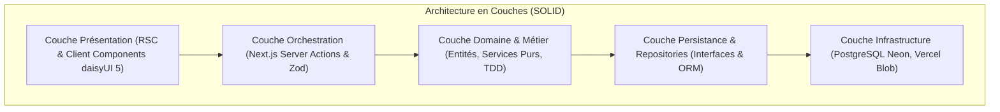
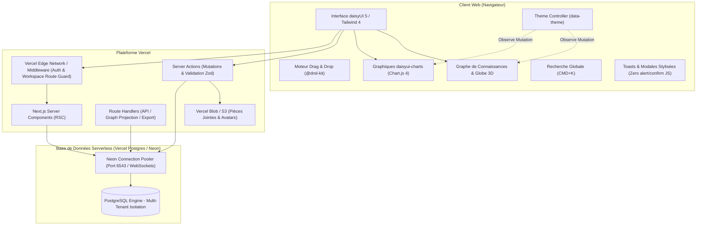
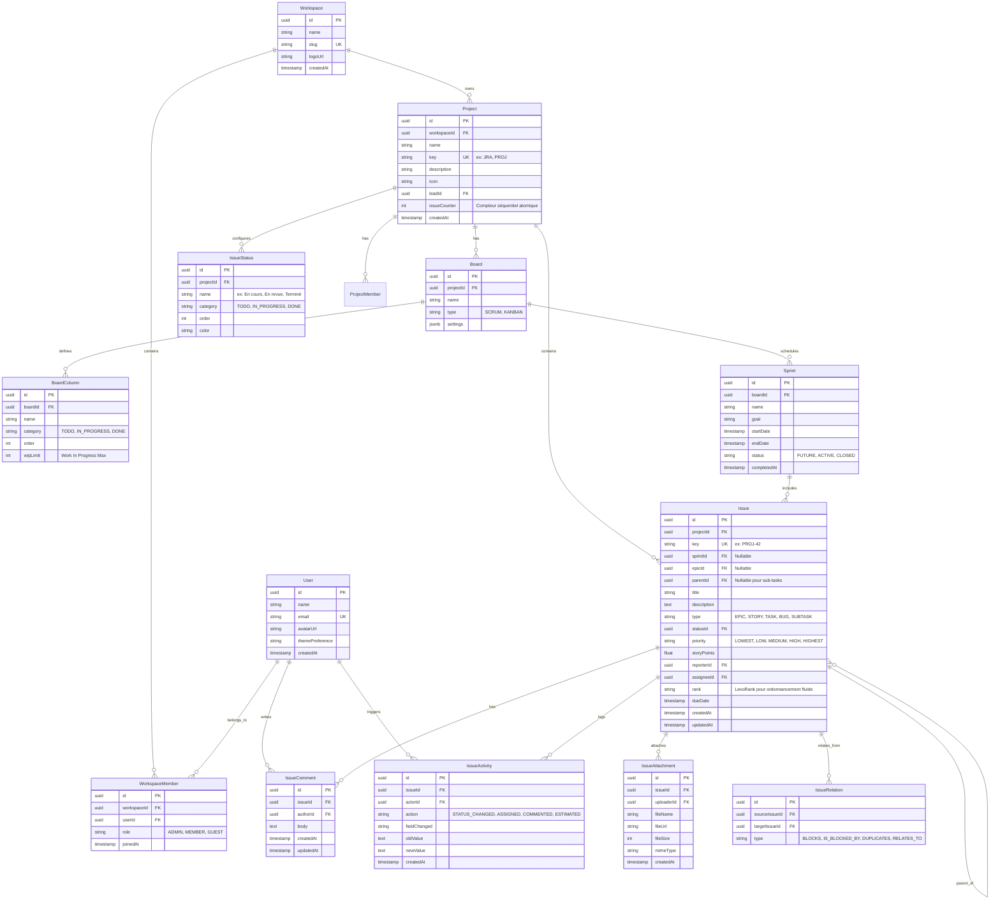
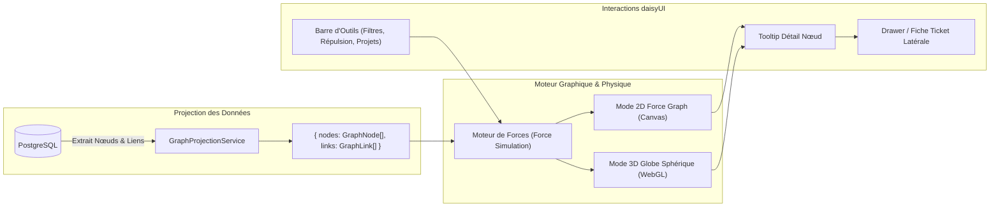
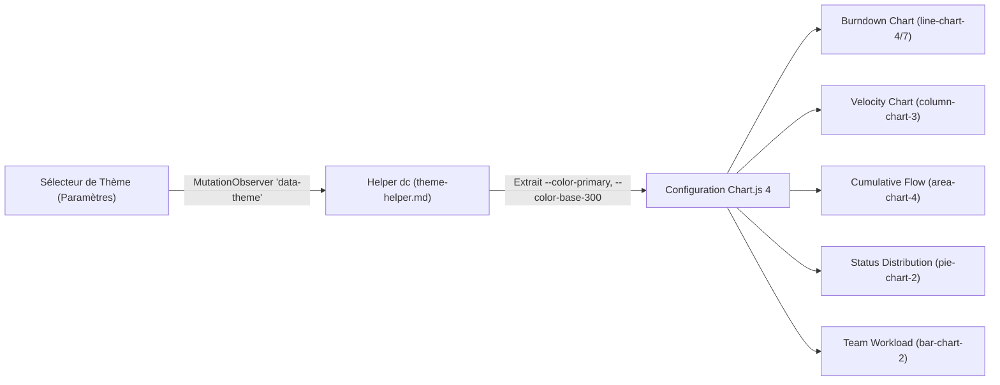

# Spécification d'Architecture Technique (ARCHITECTURE.md)

Ce document décrit l'architecture complète, les modèles de données, le design system, l'infrastructure de déploiement et les principes d'ingénierie logicielle pour la réalisation d'une application de gestion de projet moderne type **Jira**.

---

## 1. Vue d'Ensemble & Objectifs

L'application vise une parité fonctionnelle complète avec les capacités clés d'Atlassian Jira (gestion multi-projets, tickets hiérarchisés, tableaux Scrum/Kanban, gestion du backlog, sprints, rapports de vélocité, burndown charts, journal d'activité), enrichie par une **vue globale en graphe / globe interactif inspirée d'Obsidian** pour cartographier les interconnexions du projet.

Les piliers fondateurs sont :
- **Excellence d'Ingénierie Logicielle** : Respect strict des principes **TDD**, **KISS**, **DRY** et **SOLID**.
- **Performance & Réactivité** : Socle **Next.js 15+ (App Router)** avec React Server Components et React 19.
- **Design System Sémantique** : Intégration avancée de **Tailwind CSS 4** et **daisyUI 5**.
- **Analytique & Visualisation Thématique** : Tableaux de bord propulsés par **`daisyui-charts`** (Chart.js 4 + helper `dc`).
- **Cartographie Réseau & Globe 3D** : Visualisation en graphe de forces (2D / Globe 3D) des projets, epics, tâches et dépendances.
- **Thématisation Dynamique sans Scintillement (Zero FOUC)** : Personnalisation instantanée dans les paramètres.
- **Infrastructure 100% Serverless** : Déploiement Vercel avec base de données relationnelle **PostgreSQL Serverless (Neon / Vercel Postgres)** sans limitation de pool de connexions.

---

## 2. Principes d'Ingénierie Logicielle (TDD, KISS, DRY, SOLID)



### 2.1 TDD (Test-Driven Development)
Le développement suit le cycle vertueux **Red-Green-Refactor** :
- **Tests Unitaires & Logique Pure (Vitest)** :
  - Tout algorithme métier (calcul de burndown, ordonnancement LexoRank des tickets, transition de statuts de workflow, projection du graphe) est testé avant son écriture.
  - Vitesse d'exécution maximale en mémoire avec mocks typés.
- **Tests d'Intégration (Vitest + React Testing Library)** :
  - Test des Server Actions et interactions composants avec vérification des états loading, empty, error et loaded.
- **Tests End-to-End (Playwright)** :
  - Validation des parcours critiques : glisser-déposer sur le tableau Kanban, création et clôture d'un sprint Scrum, commutation de thèmes daisyUI.

### 2.2 KISS (Keep It Simple, Stupid)
- Architecture pragmatique : pas de microservices superflus, un monolithe modulaire Next.js hautement scalable.
- Favoriser les APIs Web standards et les composants HTML5 natifs stylisés par daisyUI (`<dialog>`, `<details>`, `data-theme`).
- Modèles de données directs sans sur-abstraction.

### 2.3 DRY (Don't Repeat Yourself)
- **Validation Unique (Single Source of Truth)** : Les schémas **Zod** (`src/lib/validations/`) définissent à la fois le typage TypeScript (`z.infer`), la validation des formulaires client et la validation des Server Actions.
- **Composants d'Interface Réutilisables** : factorisation des composants récurrents (`IssueBadge`, `StatusDropdown`, `UserAvatar`, `MetricCard`).
- **Helper Centralisé daisyui-charts (`dc`)** : Une seule source pour l'extraction dynamique des couleurs CSS de thèmes.

### 2.4 SOLID dans l'Application
- **Single Responsibility (SRP)** : Séparation stricte entre Server Actions (orchestration HTTP/session), Services de Domaine (règles métier pures) et Repositories (SQL/ORM).
- **Open/Closed (OCP)** : Moteur de rendu de tickets et nœuds de graphe extensible par registre sans altérer le moteur central.
- **Liskov Substitution (LSP)** : Abstraction des services de stockage (`StorageProvider`) permettant d'interchanger Vercel Blob et AWS S3 en toute transparence.
- **Interface Segregation (ISP)** : Interfaces client réduites aux besoins stricts des composants (ex: `IssueCardProps` ne requiert que les métadonnées affichées).
- **Dependency Inversion (DIP)** : Les services de domaine dépendent d'interfaces de persistance et non de clients SQL couplés en dur.

---

## 3. Diagramme d'Architecture Système



---

## 4. Modèle de Données Relationnel (ERD)



---

## 5. Vue Graphe de Connaissances & Globe Interactif (Inspiration Obsidian)

L'application intègre une vue cartographique interactive permettant d'appréhender d'un coup d'œil l'ensemble de l'écosystème : dépendances, goulets d'étranglement, clusters d'Epics et sous-tâches orphelines.



### 5.1 Modèle de Données du Graphe

```typescript
export interface GraphNode {
  id: string;               // UUID de l'entité
  key: string;              // "PROJ-101" ou nom du projet
  label: string;            // Titre de l'issue ou du projet
  type: 'PROJECT' | 'EPIC' | 'STORY' | 'TASK' | 'BUG' | 'SUBTASK';
  statusCategory: 'TODO' | 'IN_PROGRESS' | 'DONE';
  priority: string;
  storyPoints?: number;
  val: number;              // Rayon du nœud (calculé selon points et degré de liens)
  colorToken: string;       // Token sémantique daisyUI ('primary', 'secondary', 'info', 'error', 'success')
}

export interface GraphLink {
  source: string;           // ID source
  target: string;           // ID cible
  type: 'BELONGS_TO_PROJECT' | 'BELONGS_TO_EPIC' | 'PARENT_OF' | 'BLOCKS' | 'RELATES_TO';
  colorToken: string;       // 'base-300' ou 'error' pour les blocages
  dashed?: boolean;         // Pointillés pour liens logiques / blocages
}
```

### 5.2 Rendu & Modes d'Affichage
1. **Mode 2D Force-Directed (Planétarium)** :
   - Simulation physique simulant répulsion de Coulomb, tension des liens et gravité centrale.
   - Les Projets agissent comme des étoiles massives centrales, entourés de leurs Epics en orbite, gravitant autour de leurs Stories et Tâches.
2. **Mode Globe 3D Sphérique (Cosmos)** :
   - Projection des nœuds sur la surface ou le volume d'une sphère tridimensionnelle interactive en WebGL.
   - Rotation fluide à la souris ou au tactile, zoom dynamique, impression de "globe des projets".
3. **Harmonie Thématique daisyUI** :
   - Les couleurs de rendu sur le canvas Canvas/WebGL sont obtenues via le helper `dc.color()`.
   - À chaque bascule de thème dans les paramètres, le graphe réapplique les couleurs sans réinitialiser la physique.

### 5.3 Ergonomie & Filtrage
- **Barre d'outils flottante (`join`)** :
  - Bascule rapide 2D / Globe 3D.
  - Filtre d'affichage : Masquer les tickets terminés (`DONE`), afficher uniquement les liens bloquants (`BLOCKS`), isoler un projet spécifique.
  - Curseur (`range range-primary`) pour ajuster la force de répulsion et la distance des liens.
- **Interaction Nœud** :
  - Survol : Halo lumineux et illumination du chemin de dépendances directes (nœuds voisins), atténuation (opacité 0.15) du reste du graphe.
  - Clic : Ouverture instantanée du tiroir latéral daisyUI (`drawer`) pour consulter et éditer l'issue en direct sans perdre le contexte cartographique.

---

## 6. Architecture UI / UX avec daisyUI 5 & daisyui-dashboard-skill

*(Voir la spécification détaillée et les chartes complètes dans [**`DESIGN.md`**](file:///C:/Users/james/OneDrive/Documents/1AA-M1/bisa/DESIGN.md))*

### 6.1 Structure du Shell Applicatif (Layout)
L'application adopte le gabarit recommandé par le skill `daisyui-dashboard-skill` :
- **Barre latérale rétractable** : Basée sur `drawer lg:drawer-open` (fixe sur grand écran, tiroir escamotable sur mobile).
- **En-tête supérieur (Sticky Navbar)** :
  - Sélecteur de Workspace / Projet actif (`dropdown`).
  - Fil d'Ariane sémantique (`breadcrumbs`).
  - Barre de recherche globale CMD+K (`kbd` daisyUI).
  - Bouton d'action principal : `btn btn-primary btn-sm` **"+ Créer un ticket"**.
  - Contrôleur de thème rapide (`theme-controller` toggle soleil/lune ou dropdown de sélection).
  - Avatar utilisateur avec menu déroulant.
- **Barre latérale de navigation projet** :
  - *Tableau Kanban / Scrum* (`menu` daisyUI avec icônes Lucide).
  - *Backlog & Planification*.
  - *Vue Graphe & Globe (Obsidian View)*.
  - *Feuille de route (Roadmap)*.
  - *Rapports & Analyses (Dashboard)*.
  - *Paramètres du projet*.

### 6.2 Système de Couleurs & Tokens Sémantiques
- Surfaces principales : `bg-base-100` (cartes, tickets, modales).
- Surfaces de fond : `bg-base-200` (toile de fond du tableau de bord, colonnes Kanban).
- Lignes et bordures : `border-base-300` (séparateurs discrets).
- Textes : `text-base-content` et `text-base-content/70`.
- Teintes adoucies pour les badges et états : `badge-soft`, `btn-soft`, `alert-soft`.
- Composants groupés : `join` pour les filtres et segmentations.

### 6.3 Système de Notifications Toasts & Modales Stylisées (Bannissement des Alertes JS Natives)
- **Bannissement de `window.alert()`, `window.confirm()` et `window.prompt()`** : Aucune alerte brute du navigateur n'est tolérée.
- **Toasts sémantiques réactifs** : Tout retour d'erreur d'API, de validation ou de succès passe par le `ToastProvider` global (`toast toast-bottom toast-end`, `alert alert-{type} alert-soft shadow-lg border border-base-300`) avec fermeture automatique et support d'actions de réessai.
- **Modales de confirmation stylisées** : Toute action sensible (suppression de ticket, clôture de sprint) est encadrée par un composant `<ConfirmModal />` reposant sur la balise native `<dialog class="modal">` daisyUI 5 avec backdrop flouté et boutons sémantiques explicites.

### 6.4 Standardisation des États de Chargement (Skeletons & Loaders daisyUI 5)
- **Règle 100% daisyUI-First** : L'intégralité du design et des composants UI s'appuie sur la bibliothèque daisyUI 5 (Tailwind CSS 4 étant réservé au positionnement et aux espacements).
- **Skeletons sémantiques** : Tout affichage en attente de données (cartes Kanban, tableaux de bord, profil, métriques) utilise les composants `skeleton` daisyUI épousant fidèlement la géométrie finale pour éradiquer le CLS (*Cumulative Layout Shift*).
- **Loaders natifs daisyUI** : Tout traitement asynchrone (boutons en cours de sauvegarde, spinners de requêtes) utilise exclusivement `<span class="loading loading-spinner"></span>` (ou `loading-dots`, `loading-ring`), avec interdiction de tout spinner SVG non-daisyUI ou GIF de chargement.

---

## 7. Architecture des Tableaux de Bord & Graphiques (`daisyui-charts`)

L'application intègre le catalogue `daisyui-charts` pour afficher des visualisations professionnelles réactives aux changements de thèmes :



### 7.1 Recettes `daisyui-charts` Implémentées
1. **Sprint Burndown Chart** (`line-chart-4` & `line-chart-7`) : Ligne idéale en `base-content/40` pointillée, ligne réelle en `primary`.
2. **Velocity Chart** (`column-chart-3`) : Colonnes bicolores comparant points engagés (`base-300`) et points terminés (`success`).
3. **Diagramme de Flux Cumulé (CFD)** (`area-chart-4`) : Aires empilées avec opacités douces (`info`, `warning`, `primary`, `success`).
4. **Répartition des Tickets par Type & Priorité** (`pie-chart-2`) : Doughnut chart avec total au centre.
5. **Charge par Collaborateur** (`bar-chart-2`) : Barres horizontales indiquant le volume de tickets et points par membre.

### 7.2 Les 4 États Obligatoires
Chaque composant de données ou graphique gère rigoureusement : `Loading` (skeleton), `Empty` (message d'action sans faux zéros), `Error` (alert-error + retry), et `Loaded`.

---

## 8. Gestion Dynamique des Thèmes dans les Paramètres

1. **Thèmes supportés** :
   - Clairs : `light`, `corporate`, `nord`, `emerald`.
   - Sombres : `dark`, `business`, `dim`, `synthwave`.
2. **Architecture Zéro FOUC (Anti-Scintillement)** :
   - Sauvegarde dans un **Cookie HTTP** (`app-theme`) et dans le **`localStorage`**.
   - Lecture immédiate côté serveur dans `layout.tsx` : `<html data-theme={themeCookie}>`.
   - Script inline minuscule dans `<head>` pour garantir un premier affichage sans flash pour les visiteurs anonymes.
   - Branchement d'un `MutationObserver` réactif synchronisé avec `dc.mount()` pour actualiser instantanément les graphiques et le graphe Obsidian.

---

## 9. Stratégie de Déploiement Vercel & Base de Données

1. **Vercel Serverless & Edge** :
   - Edge Middleware pour la validation des sessions JWT et le routage de workspace sans latence.
   - Serverless Functions scalables pour les Server Actions et les calculs de projection de graphe.
   - Mise en cache intelligente par tags (`revalidateTag`).
2. **PostgreSQL Serverless (Neon / Vercel Postgres)** :
   - Intégration native sans restriction via le package `@neondatabase/serverless` avec connection pooling WebSocket/HTTP (port 6543).
   - Schéma relationnel versionné via migrations automatisées en CI/CD.
3. **Stockage des Fichiers** :
   - Vercel Blob / S3 avec génération d'URLs signées pour les captures d'écrans et pièces jointes.
