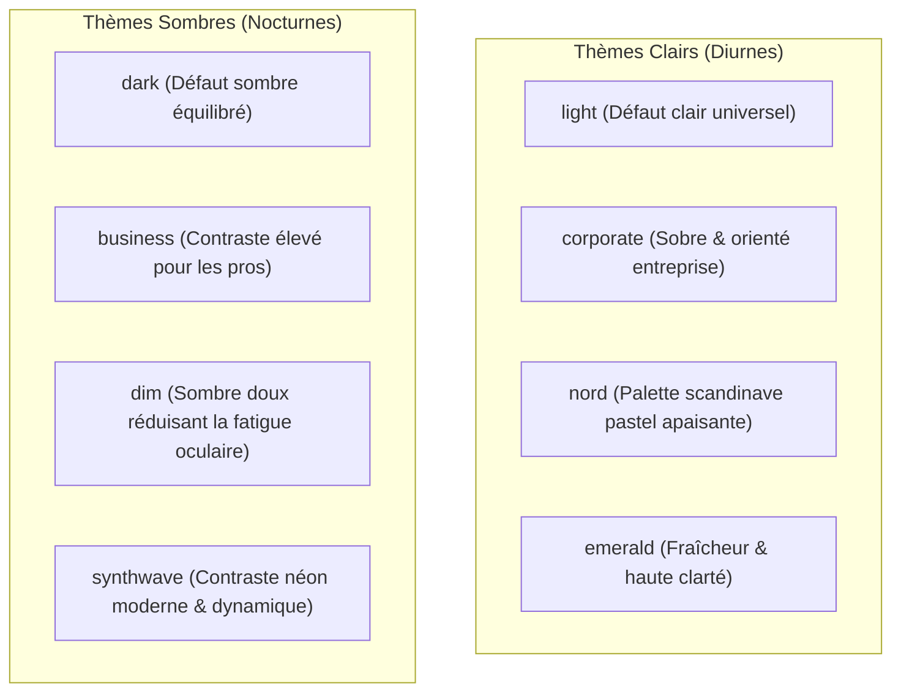
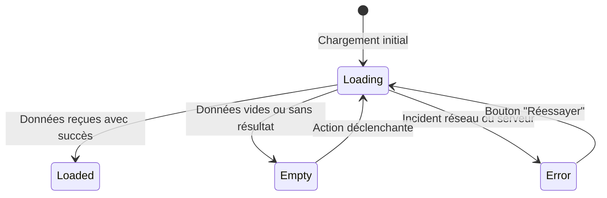

# Charte Graphique, Design System & Ergonomie UI/UX (DESIGN.md)

Ce document constitue la référence officielle du **Design System**, de la charte ergonomique et de l'architecture d'interface utilisateur pour notre application de gestion de projet type **Jira**, enrichie d'une **vue graphe/globe interactive type Obsidian**.

Il concrétise les directives des compétences **daisyUI 5**, **daisyui-dashboard-skill** et **daisyui-charts** pour offrir une expérience utilisateur à la fois professionnelle, moderne, accessible et parfaitement réactive aux changements de thèmes.

---

## 1. Vision & Philosophie de Design

1. **Esthétique "Linear meets Jira"** : Allier la richesse fonctionnelle et la granularité de Jira à la clarté visuelle épurée, la vélocité et l'élégance minimaliste des outils de nouvelle génération (Linear, GitHub Projects, Raycast).
2. **Densité d'Information Maîtrisée** : Conçu pour les développeurs, chefs de projet et ingénieurs. Privilégier une haute densité (`btn-sm`, `input-sm`, `table-sm`) afin de limiter le défilement inutile sans sacrifier la lisibilité.
3. **Thématisation 100% Dynamique (Zero-Hardcoded-Color)** : L'ensemble des surfaces, textes, bordures, graphiques et visualisations 3D s'adaptent instantanément aux thèmes daisyUI (`light`, `dark`, `corporate`, `nord`, `dim`, etc.) sans aucun scintillement.
4. **Accessibilité & Inclusivité Native (WCAG AA)** : Contraste minimal de 4.5:1 sur tous les textes, navigation intégrale au clavier (`kbd`), et non-dépendance à la couleur seule pour transmettre une information d'état.
5. **100% daisyUI-First (Interdiction de réinventer l'existant)** : L'ensemble des composants de l'application (boutons, badges, cartes, modales, tiroirs, formulaires, menus, accordéons, avatars, toasts, skeletons, loaders) s'appuie obligatoirement sur la bibliothèque **daisyUI 5**. Tailwind CSS 4 intervient exclusivement pour le positionnement, les grilles et les espacements (`flex`, `grid`, `gap-*`, `p-*`).

---

## 2. Système de Couleurs & Tokens Sémantiques daisyUI 5

L'interface repose exclusivement sur les tokens de design sémantiques fournis par **daisyUI 5** et **Tailwind CSS 4**. **L'utilisation de codes hexadécimaux (`#fff`) ou de classes utilitaires de couleur fixe (`bg-white`, `text-black`, `bg-gray-100`) est formellement bannie.**

### 2.1 Cartographie des Tokens Sémantiques

| Token Sémantique | Rôle & Usage dans l'Application | Rendu attendu |
|---|---|---|
| `base-100` | Surface principale : Fond des cartes, cartes de tickets Kanban, tiroirs, modales, panneaux de détail. | Surface claire (en thème clair) ou sombre (en thème sombre). |
| `base-200` | Fond global de l'application, fond des colonnes du tableau Kanban, en-tête des tables de données. | Teinte légèrement contrastée par rapport à `base-100`. |
| `base-300` | Bordures (`border-base-300`), séparateurs (`divider`), skeletons de chargement, lignes de grille des graphiques. | Délimitation subtile mais distincte. |
| `base-content` | Typographie principale pour tous les titres et textes fondamentaux. | Contraste supérieur à 7:1 sur `base-100`. |
| `base-content/70` | Textes secondaires : descriptions, horodatages, clés de tickets secondaires, labels de métadonnées. | Lisibilité confortable sans rivaliser avec le titre. |
| `primary` | Action principale unique par vue (`btn-primary`), séries de données clés, nœuds "Projets" du graphe. | Teinte d'accentuation majeure de la marque. |
| `secondary` | Actions secondaires, jalons, nœuds "Epics" du graphe, deuxième série comparative. | Complémentaire harmonieuse. |
| `accent` | Indicateurs de focus, points d'intérêt particuliers, tags distinctifs. | Touche visuelle ponctuelle. |
| `neutral` | Chrome d'interface foncé (tooltips, fonds d'en-tête contrastés, raccourcis clavier `kbd`). | Neutre et discret. |
| `info` | Statut "En cours", types "Task" et "Story", messages d'information. | Bleu sémantique. |
| `success` | Statut "Terminé", tickets livrés, objectifs de sprint atteints, tests passés. | Vert sémantique. |
| `warning` | Statut "En revue", alertes de dépassement de limite WIP, tickets bloquants imminents. | Orange/Ambre sémantique. |
| `error` | Statut "Bloqué", type "Bug", suppressions destructives, erreurs de validation. | Rouge sémantique. |

---

## 3. Matrice des Thèmes Supportés dans les Paramètres

L'application propose 8 thèmes soigneusement sélectionnés pour convenir à tous les environnements de travail :

### Règles de Thématisation
- **Persistance double** : Le thème sélectionné est enregistré dans un Cookie HTTP `app-theme` (pour le rendu SSR Next.js sans FOUC) et dans `localStorage` (pour la synchronisation client).
- **Prévisualisation interactive** : La page `Paramètres > Apparence` présente des cartes miniatures pour chaque thème avec pastilles montrant `primary`, `secondary`, `accent`, `base-100` et `base-200`.

---

## 4. Composants & Motifs daisyUI 5 (Block Patterns)

Conformément à la mise à niveau **daisyUI 5**, les motifs d'interface obéissent aux standards suivants :

### 4.1 Shell Applicatif (Layout Global)
- **Barre latérale (Sidebar)** : Intégrée avec le composant `drawer lg:drawer-open` :
  - Sur écran large (`≥ 1024px`) : barre latérale persistante bordée par `border-r border-base-300 bg-base-100`.
  - Sur mobile/tablette (`< 1024px`) : tiroir coulissant escamotable déclenché par un bouton hamburger accessible.
- **En-tête supérieur (Sticky Navbar)** :
  - `navbar bg-base-100 border-b border-base-300 sticky top-0 z-30`.
  - Contient le sélecteur de projet (`dropdown`), le fil d'Ariane (`breadcrumbs`), la recherche globale (`kbd Cmd+K`), le bouton primaire unique **"+ Créer un ticket"** (`btn btn-primary btn-sm`), le contrôleur rapide de thème, et l'avatar utilisateur.

### 4.2 Tableau Kanban & Cartes d'Issues
- **Colonnes Kanban** :
  - Conteneur : `bg-base-200 rounded-box p-3 flex flex-col gap-3 min-w-[280px] border border-base-300`.
  - En-tête de colonne : Titre en `font-semibold text-sm`, compteur de tickets (`badge badge-neutral badge-sm`), et indicateur de limite WIP (`badge badge-warning badge-soft` en cas de surcharge).
- **Carte de Ticket (Issue Card)** :
  - Conteneur : `card bg-base-100 border border-base-300 shadow-xs hover:border-primary/50 transition-all cursor-grab active:cursor-grabbing`.
  - Structure interne :
    - En-tête : Clé du ticket (`text-xs font-mono font-medium text-base-content/70 hover:text-primary`), type d'issue matérialisé par un badge adouci (`badge badge-soft badge-xs`), menu d'actions rapides (`dropdown`).
    - Corps : Titre concis sur 2 lignes max (`text-sm font-medium line-clamp-2`).
    - Pied de carte : Tags/labels, Story points (`badge badge-neutral badge-xs`), avatar de l'assigné (`avatar size-6 rounded-full`), indicateur de priorité avec icône sémantique.

### 4.3 Formulaires & Champs de Saisie
- **Champs de saisie** : daisyUI 5 remplace l'ancien `form-control` par `<fieldset class="fieldset">`, `<legend class="fieldset-legend">` et `<label class="label">`.
- **Bordures par défaut** : En daisyUI 5, les `input`, `select`, `textarea` sont bordés par défaut. Ne pas ajouter `input-bordered`. Pour un champ sans bordure (ex: édition inline de titre de ticket), utiliser `input-ghost`.
- **Groupes de contrôles** : Les filtres et boutons segmentés doivent employer la classe `join` (ex: `join join-horizontal`).

### 4.4 Système de Notifications Toasts (Interdiction formelle de `alert()` JS)
**Règle absolue : Aucun message d'information, d'avertissement ou d'erreur ne doit utiliser `window.alert()`, `window.prompt()` ou des boîtes de dialogue JavaScript natives brutes non stylisées.**

- **Architecture des Toasts** :
  - Composant conteneur fixe : `
`.
  - Carte d'alerte sémantique : `
`.
  - Types sémantiques :
    - Erreurs : `alert-error alert-soft` avec icône Lucide `AlertCircle` rouge sémantique.
    - Succès : `alert-success alert-soft` avec icône `CheckCircle2` verte sémantique.
    - Avertissements : `alert-warning alert-soft` avec icône `AlertTriangle` ambre.
    - Informations : `alert-info alert-soft` avec icône `Info` bleue.
  - Micro-interactions : Disparition automatique temporisée (3500 ms), barre de progression de défilement discrète, bouton de fermeture croix accessible (`btn btn-ghost btn-xs btn-circle`).

### 4.5 Pop-ups, Modales & Dialogues Stylisés (Interdiction formelle de dialogues JS bruts)
**Règle absolue : Aucune boîte de confirmation (`window.confirm()`) ou pop-up native brute du navigateur n'est autorisée.**

- **Structure d'une Modale daisyUI 5** :
  - Balise native HTML5 : `<dialog class="modal modal-bottom sm:modal-middle">`.
  - Boîte modale stylisée : `
`.
  - En-tête : Titre net (`text-lg font-bold text-base-content`) avec bouton de fermeture croix en haut à droite.
  - Corps : Typographie équilibrée, explication claire de l'impact de l'action.
  - Barre d'action : `
` :
    - Bouton d'annulation neutre : `btn btn-ghost btn-sm` *"Annuler"*.
    - Bouton de confirmation contextualisé : `btn btn-error btn-sm` *"Supprimer le ticket"* ou `btn btn-primary btn-sm` *"Enregistrer"*.
  - Backdrop accessible : `<form method="dialog" class="modal-backdrop bg-neutral/40 backdrop-blur-xs"><button>fermer</button></form>`.
  - Fermeture native au clavier : Support immédiat de la touche `Échap`.

### 4.6 Chargements, Skeletons & Loaders daisyUI 5 (Bannissement des spinners bruts/GIFs)
**Règle absolue : L'intégralité des états de chargement doit exclusivement employer les composants `skeleton` et `loading` de daisyUI 5. Aucun GIF, spinner SVG artisanal ou animation CSS non documentée n'est toléré.**

- **Skeletons de Chargement Sémantiques** :
  - Chaque vue ou carte de données en attente affiche des placeholders avec la classe daisyUI `skeleton` épousant fidèlement la géométrie finale :
    - Carte d'issue Kanban en chargement : `

`.
    - Tableau de données : lignes alternées avec `

`.
    - Cartes analytiques & Graphiques : `

`.
  - Empêche tout décalage cumulatif de mise en page (*Cumulative Layout Shift - CLS*).
- **Loaders & Spinners daisyUI 5** :
  - **Dans les boutons lors d'une action asynchrone** : `<button class="btn btn-primary btn-sm" disabled> Enregistrement...</button>`.
  - **Indicateurs de synchronisation ou pagination** : `` ou ``.
  - **Variantes autorisées selon le contexte** : `loading-spinner` (défaut universel), `loading-dots` (actions discrètes), `loading-ring` (statuts macro).

---

## 5. Visualisation en Graphe & Globe Style Obsidian

Cette vue distinctive cartographie l'écosystème global de gestion de projet.

```mermaid
flowchart LR
    subgraph GraphControls["Barre de Contrôles Flottante (join)"]
        Toggle["2D Force Graph / Globe 3D"]
        Filter["Filtre : Statut / Type / Liens"]
        Physics["Curseur de Répulsion (range-sm)"]
    end

    subgraph VisualCanvas["Scène Graphique (Canvas 2D / WebGL)"]
        ProjNode["Nœuds Projets (primary - Taille XXL)"]
        EpicNode["Nœuds Epics (secondary - Taille XL)"]
        StoryNode["Nœuds Stories / Tâches (info - Taille M)"]
        BugNode["Nœuds Bugs (error - Taille M)"]
        DoneNode["Nœuds Terminés (success)"]
        Links["Arêtes : Solides (Parenté) / Pointillés (Blocage)"]
    end

    subgraph SideInspection["Inspection Rapide"]
        HoverCard["Tooltip d'Aperçu au Survol"]
        DetailDrawer["Tiroir Latéral daisyUI (drawer-side)"]
    end

    GraphControls --> VisualCanvas
    VisualCanvas --> HoverCard
    HoverCard --> DetailDrawer
```

### 5.1 Règles Visuelles du Graphe
- **Hiérarchie Spatiale & Tailles de Nœuds** :
  - **Projets** : Diamètre 24px, couleur `--color-primary`, bordure halo luminescente.
  - **Epics** : Diamètre 18px, couleur `--color-secondary`.
  - **Stories & Tâches** : Diamètre 10px à 14px (proportionnel au nombre de Story Points).
  - **Bugs** : Diamètre 12px, couleur `--color-error`.
  - **Sous-tâches** : Diamètre 8px, couleur `--color-info`.
- **Arêtes & Dépendances** :
  - Liens hiérarchiques (Epic vers Story, Parent vers Subtask) : Ligne continue fine `base-300` avec flèche d'orientation subtile.
  - Liens bloquants (`BLOCKS`) : Ligne pointillée contrastée `color-error` pulsante.
- **Interactivité Ergonomique** :
  - *Survol* : Le nœud ciblé grossit de 20%, ses liaisons directes s'illuminent en surbrillance, et les éléments non connectés s'atténuent (opacité 0.15).
  - *Clic* : Ouvre instantanément le panneau latéral de détails daisyUI (`drawer`) sans perte de l'état de zoom.

---

## 6. Tableaux de Bord & Graphiques (`daisyui-charts`)

Tous les graphiques (Burndown, Vélocité, Flux Cumulé, Répartition) obéissent à la charte `daisyui-charts` :

### 6.1 Principes Non-Négociables de Tracé
1. **Couleurs Sémantiques Uniquement** : Extraction via `dc.color('primary')`, `dc.color('base-300')`, `dc.alpha('primary', 20)`. **Aucune couleur codée en dur dans Chart.js.**
2. **Réactivité aux Thèmes** : Re-génération dynamique et sans saccade via MutationObserver sur l'attribut `data-theme`.
3. **Typographie & Grille** :
   - Axe et étiquettes : `base-content/70`, police de caractères identique à l'application.
   - Lignes de grille : `base-300` avec opacité très légère (jamais de grilles noires ou contrastées).
   - Tooltips : Fond `neutral`, texte `neutral-content`, bords arrondis (`rounded-box`).
4. **Dimensions & Disposition** :
   - Conteneur `relative` avec hauteur explicite (`h-64` pour cartes standards, `h-72` pour diagrammes étendus).
   - `maintainAspectRatio: false` systématique.

---

## 7. Règle des 4 États Visuels d'un Bloc

Conformément à `daisyui-dashboard-skill`, aucun composant ou bloc de données ne peut se limiter à son seul affichage chargé :

1. **État Loading (Chargement)** :
   - Remplacement du contenu par des skeletons daisyUI (`skeleton h-4 w-3/4`, `skeleton h-32 w-full`) épousant la disposition finale pour éviter tout décalage cumulatif de mise en page (CLS).
2. **État Empty (Vide)** :
   - Illustration ou icône Lucide stylisée en `text-base-content/30`.
   - Titre court expliquant la situation (ex: *"Aucun ticket dans le backlog"*).
   - Sous-titre rassurant et action claire (`btn btn-primary btn-sm` *"Créer une première issue"*).
3. **État Error (Erreur)** :
   - Bannière douce `alert alert-error alert-soft`.
   - Message compréhensible et bouton de réessai (`btn btn-outline btn-sm` *"Réessayer"*).
4. **État Loaded (Chargé)** :
   - Rendu net avec micro-animations d'apparition (`transition-opacity duration-200`).

---

## 8. Stratégie de Contenu & Micro-Typographie (Microcopy)

- **Langue & Registre** : Français professionnel B2B, vouvoiement courtois, tournures directes et claires.
- **Libellés des Boutons** : Toujours au format **[Verbe d'action à l'infinitif] + [Objet précis]** (ex: *"Créer un ticket"*, *"Démarrer le sprint"*, *"Supprimer le projet"* — jamais de *"OK"*, *"Valider"* ou *"Cliquez ici"*).
- **Formatage des Chiffres & Dates** :
  - Nombres : Format localisé (`Intl.NumberFormat('fr-FR')`), police à chasse fixe `tabular-nums` pour aligner les totaux de story points.
  - Dates : Format relatif pour les événements récents (*"il y a 5 min"*, *"hier à 14h30"*), date absolue dans les tableaux (*"12 sept. 2026"*).
- **Raccourcis Clavier** : Toujours stylisés avec le composant daisyUI `<kbd class="kbd kbd-sm">` (ex: `<kbd>Cmd</kbd> + <kbd>K</kbd>`).

---

## 9. Checklist d'Audit Design (Avant Livraison de Composant)

Avant de déclarer une interface ou un composant terminé :
- [ ] Zéro couleur en dur (aucun `#hex`, `rgb`, ou classe `bg-white`/`text-gray-*`).
- [ ] Testé et validé visuellement en thème **Clair (`light` ou `corporate`)** ET en thème **Sombre (`dark` ou `dim`)**.
- [ ] Les 4 états (Loading, Empty, Error, Loaded) sont rigoureusement implémentés.
- [ ] Présence d'un seul bouton d'action primaire (`btn-primary`) par écran/modale.
- [ ] Contraste textuel vérifié (ratio ≥ 4.5:1 sur tous les textes).
- [ ] Zéro `alert()`, `confirm()`, `prompt()` natifs : toutes les erreurs et feedbacks passent par les **Toasts daisyUI 5**, et toutes les confirmations passent par des **Modales `<dialog>` stylisées**.
- [ ] 100% daisyUI-First : Tous les chargements utilisent exclusivement les classes daisyUI `skeleton` et `loading loading-spinner` (aucun spinner SVG artisanal, aucun GIF).
- [ ] Navigation au clavier fluide : focus visible (`focus:outline-primary`), modale refermable avec `Échap`.
- [ ] Responsive validé : navigation fluide sur mobile (375px) via drawer et grand écran (1440px+).
